# Resumo executivo

**Veredito curto:** os 14 criativos estão bonitos, coerentes e seguros para o CFO, mas **estão desenhados para ser lidos, e os anúncios que ficam muito tempo no ar no Brasil são desenhados para ser vistos e respondidos**. Comparados com o que roda há mais tempo, falta vídeo, falta contexto de prova (de quem é o caso, a Dra. em cena), falta um convite explícito para chamar no WhatsApp e falta o rosto da Dra. Não é um problema de beleza.

**Base:** 126 anúncios ativos da Biblioteca de Anúncios da Meta (Brasil, 09/11/2026), 5 termos; 105 falam de facetas ou lentes. Desses, 43 estão no ar há 6 meses ou mais e 18 há mais de 1 ano. Detalhei os 30 melhores (seção 4), escolhidos por tempo no ar, repetição do anunciante e relevância.

## As 5 mudanças de maior impacto

1. **Vídeo antes de imagem.** 66% dos anúncios de facetas são vídeo, e 70% dos que estão no ar há 6 meses ou mais (30 de 43). Entre os 7 estáticos de mais de 6 meses dos 30 melhores, 5 são antes e depois e 1 é promoção; só 1 é arte sem foto. Os 14 criativos da Dra. são todos estáticos (a5 é só texto). Já existem 4 vídeos prontos (corte-1, corte-2, corte-3, reels-mao) com os mesmos ganchos dos anúncios 1 a 3: **colocar o vídeo como peça principal de cada um e deixar o estático como variação.**
2. **Dar contexto à prova, sem antes e depois.** As capas dos anúncios 1 a 4 já têm o close de sorriso que os anunciantes longevos usam (bom e nítido), mas ficam mudas: nada diz que é caso real da Dra., e o anúncio 5 é só texto sobre fundo liso. O que os anúncios longevos somam ao close é **movimento e pessoa**: a faceta sendo colocada, a revelação no espelho, a dentista explicando o caso. Acrescentar (a) vídeo curto de escultura/colocação, (b) legenda "caso real, imagem autorizada" nas fotos, (c) foto no anúncio 5. O antes e depois é a prova mais usada nos estáticos, mas hoje é proibido pela regra interna: **conferir com o CRO-GO** se a versão educativa com consentimento é permitida antes de decidir.
3. **Convite explícito para chamar.** 80% dos anúncios usam botão de WhatsApp, e a maioria diz isso no texto ("agende sua avaliação pelo WhatsApp", "clique em enviar mensagem"). Nos anúncios 1, 2, 3 e 5 o texto termina em "Avaliação presencial, particular.", que informa a condição mas **não convida**. Acrescentar uma frase de ação em todos ("Toque em Enviar mensagem e conte o que você quer mudar no seu sorriso") e no último cartão.
4. **Abrir com medo ou dúvida, não com tese.** Os ganchos que se repetem nos anúncios longevos são pergunta, medo e dúvida: "tem medo de ficar com sorriso artificial?" (213 dias), "há desgaste?" (511 dias), "não coloque lente antes de ver esse vídeo" (532 dias). Os anúncios 2 e 5 já fazem isso. Os anúncios 1 e 3 abrem com afirmação técnica ("dente natural não é uma cor só", "esculpida à mão") e deveriam ser o segundo ato, depois de uma pergunta.
5. **Pôr a Dra. falando, em Goiânia.** Dentista falando para a câmera é a prova principal de 6 dos 30 melhores, incluindo 2 dos 5 mais antigos. Hoje a Dra. só aparece em foto e "Goiânia" só na descrição. Gravar 3 vídeos de 15 a 25 segundos (medo de dente de chiclete, desgaste, escultura), com legenda queimada e "Goiânia e região" dito ou escrito na tela.

**O que NÃO mudar:** tom calmo, sem preço, sem emoji, sem promoção, sem urgência. Os anúncios com preço e "tempo limitado" (R$ 1.000 por arcada, R$ 1.999) existem, mas nenhum dos 43 com mais de 6 meses traz preço, e a Dra. rejeitou essa linha. O posicionamento "naturalidade e planejamento individual" é compartilhado por 55% dos anúncios, então **vale como piso, não como diferencial**: o que diferencia é a Dra. aparecer e mostrar a escultura.

## Limites deste estudo (leia antes de decidir)

- **Tempo no ar não é lucro.** A Biblioteca não mostra gasto, alcance nem conversas. "Rodando há muito tempo" é um sinal, não uma prova, e pode ser anúncio esquecido.
- A amostra é o que a Biblioteca carregou (30 a 60 por termo; ela trava a paginação). Não representa todos os anúncios do país.
- Não cliquei em nenhum botão de WhatsApp, então não sei o que cada concorrente responde nem como filtra.
- A Dra. Brenda não tem histórico de vídeo no Meta. As recomendações são hipóteses para testar, não resultados.

# 1. Método

- **Fonte:** Biblioteca de Anúncios da Meta, pela interface web (a API não está liberada). País Brasil, só anúncios ativos, 09/11/2026.
- **Termos (frase exata):** facetas em resina, facetas dentárias, lente de contato dental, design de sorriso, harmonização do sorriso.
- **Coleta:** 126 anúncios, abertos um a um na página própria (ID), com texto, data de início, botão, vídeo ou imagem e print. "Design de sorriso" rendeu só 4 anúncios e "harmonização do sorriso" 23, quase todos de clínicas que misturam harmonização facial; a maior parte dos anúncios de facetas veio dos outros três termos.
- **Seleção dos 30:** prioridade para data de início antiga (mais de 6 meses = 27 dos 30; mais de 1 ano = 13) e para anunciantes com vários anúncios ativos (Lux Sorocaba 7, Nive 6, Ramos 4, Oral Prime Uberlândia 4, Sorriadente 3, Dr. Sylvio Simioni 3, Dra. Anielle Nami 3). Entrei também com a Camargo Odontologia (Goiânia), mesmo recente, por ser concorrente local direto.
- **Complementa** a pesquisa de 29/10 (pesquisa-anuncios.md), que olhou Goiás e DF. Esta olha o Brasil inteiro e o que dura.
- **Conduta Meta:** nenhum criativo foi copiado, baixado para uso ou reproduzido. Os prints são da própria Biblioteca (interface pública) e servem só de registro da análise. O texto citado é trecho curto.

# 2. Os números (105 anúncios que falam de facetas ou lentes)

| Indicador | Todos (105) | No ar há 6 meses ou mais (43) | Há menos de 6 meses (62) |
|---|---|---|---|
| Vídeo | 66% | 70% | 63% |
| Botão/texto de WhatsApp ou mensagem | 80% | 81% | 79% |
| Fala de "avaliação" | 58% | 51% | 63% |
| Fala de "natural/naturalidade" | 55% | 60% | 52% |
| Rapidez ("mesmo dia", "sessão única", "poucas horas") | 27% | 37% | 19% |
| "Sem desgaste", conservador, reversível | 12% | 12% | 13% |
| Medo, insegurança, "sorriso artificial" | 20% | 19% | 21% |
| Pergunta no primeiro parágrafo | 15% | 23% | 10% |
| Preço em reais no texto | 8% | **0%** | 13% |
| Urgência ("vagas limitadas", "promoção") | 9% | 2% | 13% |
| Usa emoji | 72% | 74% | 71% |
| "Resina" / "lente" / "porcelana" | 46% / 47% / 12% | 53% / 33% / 14% | 40% / 56% / 11% |

Notas: percentuais por palavra-chave no texto do anúncio (não leem a imagem). Preço e urgência aparecem só nos mais novos: **preço é tática de campanha curta, não de anúncio que dura**. Entre os 43 mais longos, só 18 passam de 1 ano.

# 3. Padrões

**Formato.** Vídeo vertical domina (66%). Entre os 30 melhores: 22 vídeos, 8 imagens, nenhum carrossel. Os vídeos são curtos, com legenda queimada na tela. Os estáticos que duram são, quase sempre, antes e depois (Napoleão, 787 dias; Mateus Ribeiro, 710; Mangabeira, 425; Simioni, 402; Nami, 325).

**Ganchos que se repetem (nos 30):**

(Um anúncio pode ter mais de um gancho; as contagens somam mais que 30.)

- **Medo/dúvida/objeção (8):** "tem medo de ficar com sorriso artificial?", "há desgaste?", "não coloque lente antes de ver", "ele já tinha tentado antes", "ela achava que precisaria de lentes em todos os dentes".
- **Velocidade (7):** "em 1 dia", "mesmo dia", "em poucas horas", "sessão única".
- **Chamada local (4):** "moradores de...", "Taguatinga e região", "São Luís e região", "Cruzeiro e região".
- **Naturalidade/design (5):** "naturalidade é o verdadeiro luxo", "cada rosto tem identidade", "design de sorriso exclusivo".
- **Status/autoestima (4):** "ou você tem, ou fica pra trás", "dentes de artistas", "ria à vontade nas festas".
- **Antes e depois direto (2)** e **seleção/vaga (2):** "estamos selecionando pacientes", "paciente modelo".

**Prova (principal de cada um dos 30):** depoimento/revelação de paciente 6; bastidor do procedimento 6; antes e depois 5; close do sorriso 5; dentista falando 6; nenhuma 2. Ou seja: **28 de 30 mostram algo concreto**. Só 5 usam antes e depois, e todos os 5 são imagens.

**CTA.** WhatsApp direto em 22 dos 30; perfil do Instagram em 6 (quase todos de dentistas que misturam conteúdo e anúncio); 2 outros. O texto costuma dizer a ação: "Agende sua avaliação pelo WhatsApp", "Comenta QUERO", "Clique no botão abaixo". **A promessa é sempre uma avaliação**, e em 1 caso gratuita (Ortho Brasil).

**Oferta.** Só 6 dos 30 têm algo explícito: preço (2), promoção/avaliação gratuita (1), vaga/seleção (2), condição de laboratório (1). Os outros 24 vendem a avaliação sem oferta.

**Tom.** Quase todos animados, com emoji e exclamação. Dois polos: popular com promessa ("R$ 1.000", "sem dor, sem desgaste, sessão única", em lista) e premium sóbrio (Simioni, La Lumière, Camargo: sem emoji, texto curto, "naturalidade", foto de retrato). **O tom calmo da Dra. cabe no polo sóbrio, que tem pouca concorrência em Goiânia** e precisa de imagem e rosto para não parecer vazio.

**Concorrente local.** A Camargo Odontologia (Goiânia, 2 anúncios, ativos desde 03 e 07/11) já usa "design de sorriso exclusivo" com a mesma paleta calma e retratos. É o único de Goiânia entre os 30: a diferença que sobra para a Dra. é a escultura à mão e ela mesma.

# 4. Os 30 exemplos

### 1. Dntbras Timon

- **Cidade:** Timon-MA · **No ar:** 2 ano(s) e 11 meses (desde 05/12/2023) · **ID:** 1085409846243902
- **Formato:** vídeo vertical (Feed/Reels)
- **Gancho:** "Sofisticação e estilo!" + legenda "agora eu posso sorrir"
- **Texto principal (trecho):** "SOFISTICAÇÃO E ESTILO!😍 ➖ As facetas em resina são fixadas sobre os dentes, dando uma nova forma, cor e formato ao sorriso. ✨ ➖ Esse procedimento é rápido, prático e indolor, que deixa seu sorriso como você sempre sonhou 😍 Dê ao seu sorriso o que ele merece!…"
- **CTA:** WhatsApp: "Agende sua avaliação"
- **Prova:** depoimento (reação emocionada da paciente na cadeira)
- **Oferta:** nenhuma
- **O visual mostra:** Paciente chorando e rindo na cadeira, equipe ao lado, legendas curtas. Sem close de dente.

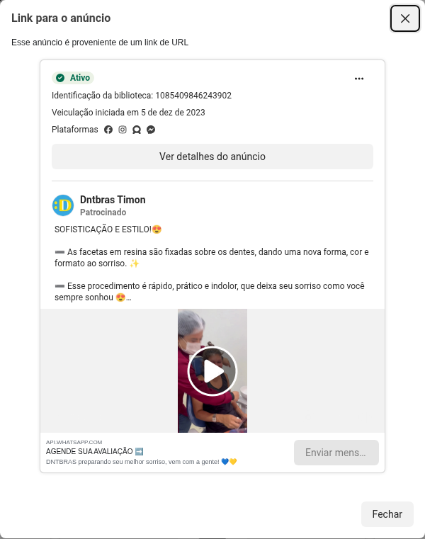{width=75%}

### 2. drbrunolouzada

- **Cidade:** Carapicuíba-SP · **No ar:** 2 ano(s) e 11 meses (desde 15/12/2023) · **ID:** 365609799207013
- **Formato:** vídeo vertical, dentista falando
- **Gancho:** "Transforme o seu sorriso com as facetas em resina" + legenda animada "Ria à vontade nas festas!"
- **Texto principal (trecho):** "Transforme o seu sorriso com as facetas em resina, a solução perfeita para conquistar um sorriso deslumbrante. Nossas facetas são cuidadosamente esculpidas para se ajustarem perfeitamente aos seus dentes, proporcionando uma aparência natural e radiante.…"
- **CTA:** WhatsApp: "Marque sua consulta hoje"
- **Prova:** dentista falando (autoridade, jaleco com CRO)
- **Oferta:** nenhuma
- **O visual mostra:** Dentista barbudo falando para a câmera, palavras-chave piscando na tela (cidade, resina, WhatsApp).

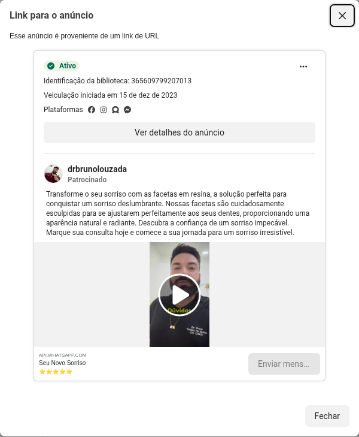{width=75%}

### 3. Clínica Gomes Estética e Odontologia

- **Cidade:** não visível · **No ar:** 2 ano(s) e 2 meses (desde 14/08/2024) · **ID:** 829858492624913
- **Formato:** vídeo vertical, dentista falando
- **Gancho:** "Você já ouviu falar sobre lentes de contato dental?"
- **Texto principal (trecho):** "Você já ouviu falar sobre lentes de contato dental? Elas são a solução perfeita para transformar seu sorriso!😁✨ Marque uma consulta e descubra como as lentes de contato dental podem mudar seu sorriso e sua vida!📅 👉Deixe seu comentário ou agende sua consulta…"
- **CTA:** Perfil do Instagram / link na bio: "agende sua consulta"
- **Prova:** explicação do passo a passo (avaliação, preparo, prova das lentes)
- **Oferta:** nenhuma
- **O visual mostra:** Dentista de frente, legendas explicando as etapas do tratamento. Nenhum dente à mostra.

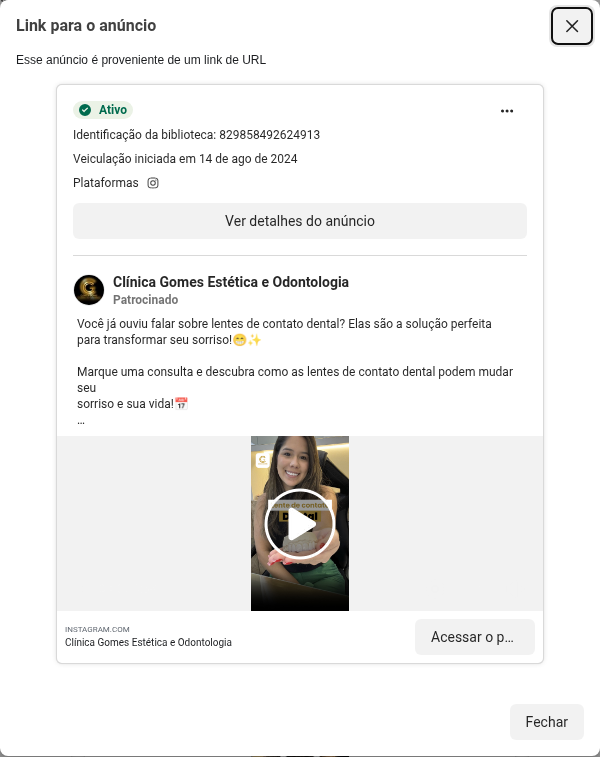{width=75%}

### 4. clinicanapoleao

- **Cidade:** não visível · **No ar:** 2 ano(s) e 1 meses (desde 13/09/2024) · **ID:** 527456416497197
- **Formato:** imagem única
- **Gancho:** "Confira o antes e depois deste paciente"
- **Texto principal (trecho):** "Confira o antes e depois deste paciente que renovou o sorriso com as facetas em resina aqui na Clínica Napoleão. 😍 Um resultado natural, harmônico e cheio de confiança! Sorrir com segurança faz toda a diferença. Venha descobrir como podemos transformar o seu…"
- **CTA:** botão "Saiba mais"; texto: "Agende sua consulta"
- **Prova:** antes e depois
- **Oferta:** nenhuma
- **O visual mostra:** Tela dividida: sorriso amarelado e irregular em cima, sorriso branco alinhado embaixo, sem texto na arte.

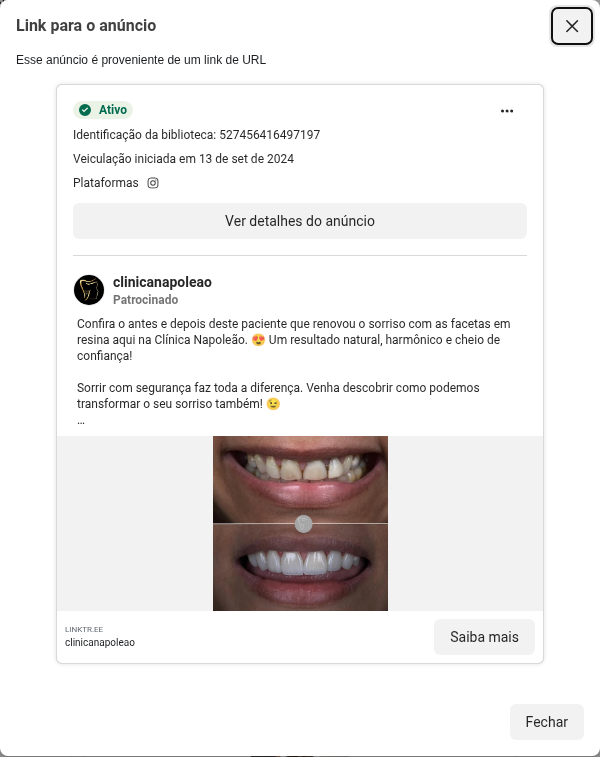{width=75%}

### 5. Mateus Ribeiro

- **Cidade:** Cruzeiro-SP ("e região") · **No ar:** 1 ano(s) e 11 meses (desde 29/11/2024) · **ID:** 586987520392723
- **Formato:** imagem única (várias versões)
- **Gancho:** "Facetas em resina para dentes perfeitos em poucas horas"
- **Texto principal (trecho):** "Transforme seu sorriso! Facetas em resina para dentes perfeitos em poucas horas. Converse conosco Send WhatsApp Message…"
- **CTA:** WhatsApp: "Converse conosco"
- **Prova:** antes e depois
- **Oferta:** rapidez ("poucas horas")
- **O visual mostra:** Dois closes empilhados (antes/depois), título "FACETAS EM RESINA – Cruzeiro e Região", botão desenhado na arte.

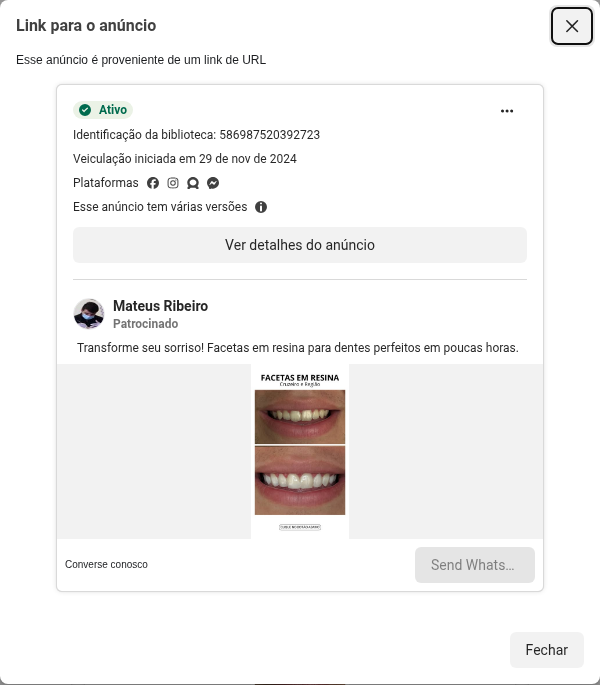{width=75%}

### 6. Ouse Sorrir C1

- **Cidade:** não visível · **No ar:** 1 ano(s) e 10 meses (desde 06/01/2025) · **ID:** 1129707125201556
- **Formato:** imagem única
- **Gancho:** "ATENÇÃO: procuram-se pessoas interessadas em colocar facetas dentárias"
- **Texto principal (trecho):** "😁✨ Transforme seu sorriso com Facetas Dentárias!✨😁 ✅ Sorriso Natural ✅ Dentes Mais Brancos ✅ Dentes Alinhados ✅ Material de Alta Qualidade ✅ Estabilidade e Segurança ✅ Durabilidade e Longevidade ✅ Conforto ✅ Recuperação Rápida ✅ Não Causa Incômodos ✅ Aumento…"
- **CTA:** WhatsApp: "Agende sua avaliação agora mesmo"
- **Prova:** nenhuma (lista de 10 benefícios)
- **Oferta:** nenhuma explícita
- **O visual mostra:** Arte de classificado de jornal com selo laranja e logo da rede. Sem foto de sorriso.

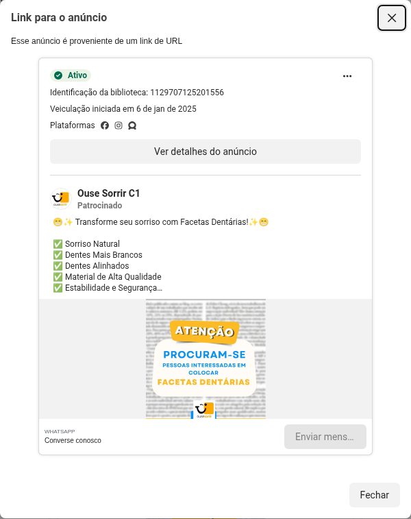{width=75%}

### 7. Dr Ricardo Moraes Oral Sin

- **Cidade:** São José do Rio Preto-SP · **No ar:** 1 ano(s) e 7 meses (desde 25/03/2025) · **ID:** 1639356046944614
- **Formato:** vídeo vertical, macro do procedimento
- **Gancho:** "Seus dentes + bonitos!" (porcelana)
- **Texto principal (trecho):** "Seus Dentes + Bonitos! 😀 As facetas dentárias são próteses de porcelana finas que são coladas na frente dos dentes, proporcionando uma aparência natural e atraente. As facetas dentárias são usadas para corrigir dentes trincados, manchados, desalinhados,…"
- **CTA:** WhatsApp: "Agende uma avaliação"
- **Prova:** bastidor (colagem das facetas na boca do paciente)
- **Oferta:** nenhuma
- **O visual mostra:** Macro da boca com afastador e luvas, a faceta sendo posicionada dente a dente, sem rosto.

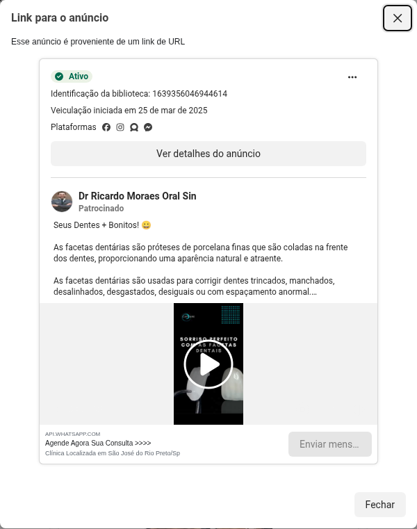{width=75%}

### 8. Dr. Sylvio Simioni

- **Cidade:** SP (CRO-SP) · **No ar:** 1 ano(s) e 5 meses (desde 26/05/2025) · **ID:** 1065673301592000
- **Formato:** vídeo vertical, bastidor da clínica
- **Gancho:** "Não coloque lente de contato dental antes de ver esse vídeo!"
- **Texto principal (trecho):** "Não coloque lente de contato dental antes de ver esse vídeo! . . 🔹Dr. Sylvio Simioni CROSP: 99.707 . . . #reels #vlog #dentista #estetica #lentesdecontatodental #dentistasp #explorar #sorriso #saude…"
- **CTA:** Perfil do Instagram
- **Prova:** bastidor (scanner, desenho digital, laboratório) + sorrisos
- **Oferta:** nenhuma
- **O visual mostra:** Corte rápido: paciente sorrindo, recepção, escaneamento, simulação verde no notebook, lente no laboratório.

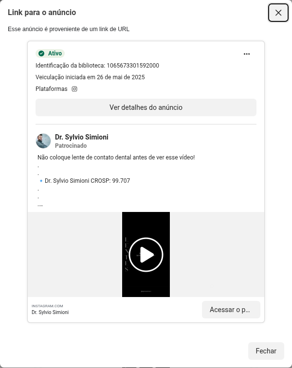{width=75%}

### 9. COP - Berimbau

- **Cidade:** não visível · **No ar:** 1 ano(s) e 4 meses (desde 16/06/2025) · **ID:** 1294691248739885
- **Formato:** vídeo vertical, dentista falando
- **Gancho:** "Seu novo sorriso começa aqui" / dúvida mais comum: "há desgaste?"
- **Texto principal (trecho):** "Seu Novo Sorriso Começa Aqui! Transforme Sua Autoestima Com Facetas em Resina. Procedimento Rápido, Seguro e Com Resultado Natural. COP Berimbau, Agende sua avaliação! FB.COM Agende Agora! Facetas em resina: resultado imediato, natural e acessível. Venha…"
- **CTA:** botão "Agendar agora"
- **Prova:** dentista falando (responde objeção)
- **Oferta:** "acessível"
- **O visual mostra:** Dentista de batom vermelho respondendo, com legenda: "preservamos a integridade… um mínimo ajuste".

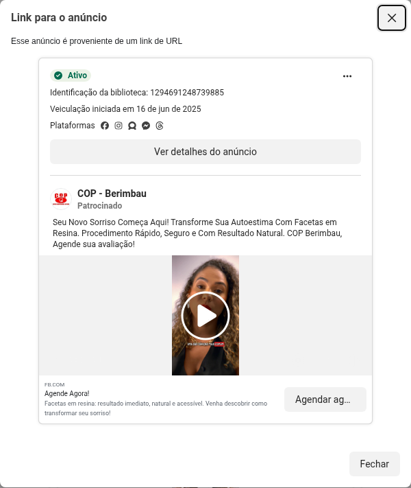{width=75%}

### 10. Dra Bruna Lopes - Odontologia Estética

- **Cidade:** não visível · **No ar:** 1 ano(s) e 3 meses (desde 22/07/2025) · **ID:** 1413255289715430
- **Formato:** vídeo vertical, storytelling
- **Gancho:** "Ele já tinha tentado antes… (Crônicas do Consultório)"
- **Texto principal (trecho):** "Ele já tinha tentado antes. Fez um tratamento em outro lugar, buscando praticidade, rapidez… Mas o resultado não foi o que esperava. Quando chegou à nossa clínica, ele veio com cautela. Mas também com esperança. E foi exatamente aí que a transformação…"
- **CTA:** perfil do Instagram ("assista, se emocione, compartilhe")
- **Prova:** história de paciente + close do resultado
- **Oferta:** nenhuma
- **O visual mostra:** Dentista sentada narrando num cenário claro, com cortes para close do sorriso final.

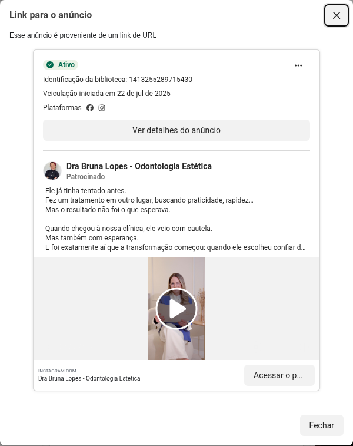{width=75%}

### 11. Soligo Odontologia

- **Cidade:** não visível · **No ar:** 1 ano(s) e 3 meses (desde 11/08/2025) · **ID:** 793842896359946
- **Formato:** vídeo vertical, dentista falando
- **Gancho:** "Tem coisas que mudam nossa vida em meses… na Soligo, um dia pode ser o suficiente"
- **Texto principal (trecho):** "Tem coisas que mudam nossa vida em meses… outras, em anos. Mas na Soligo Odontologia, um dia pode ser o suficiente. 😁 As facetas de resina permitem transformar sorrisos em poucas horas, corrigindo espaços, substituindo resinas antigas e deixando tudo mais…"
- **CTA:** WhatsApp
- **Prova:** dentista mostrando caso no tablet
- **Oferta:** rapidez ("em um dia")
- **O visual mostra:** Dentista de blusa rosa mostra no tablet o sorriso com diastema e o resultado, explica "sem muitos desgastes".

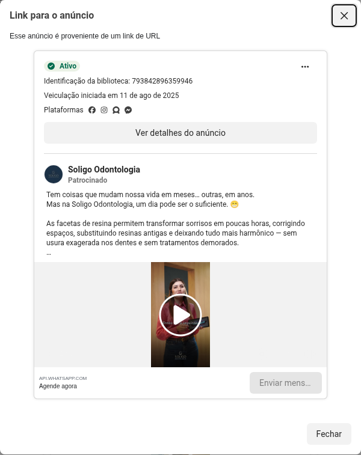{width=75%}

### 12. Centro Odontologicoo Mangabeira

- **Cidade:** não visível (bairro Mangabeira) · **No ar:** 1 ano(s) e 2 meses (desde 10/09/2025) · **ID:** 825105233190283
- **Formato:** imagem única
- **Gancho:** "Antes e depois de facetas em resina que transformam sorrisos"
- **Texto principal (trecho):** "✨ Antes e Depois de facetas em resina que transformam sorrisos! 🦷💫 Neste caso, devolvemos ao paciente não só a estética, mas também a autoconfiança e o brilho de sorrir sem medo! As facetas em resina são uma excelente opção para quem busca um resultado…"
- **CTA:** perfil do Instagram: "Agende sua avaliação"
- **Prova:** antes e depois
- **Oferta:** nenhuma
- **O visual mostra:** Tela dividida: dentes amarelados com fratura, depois sorriso claro. Rótulos "Antes" e "Depois".

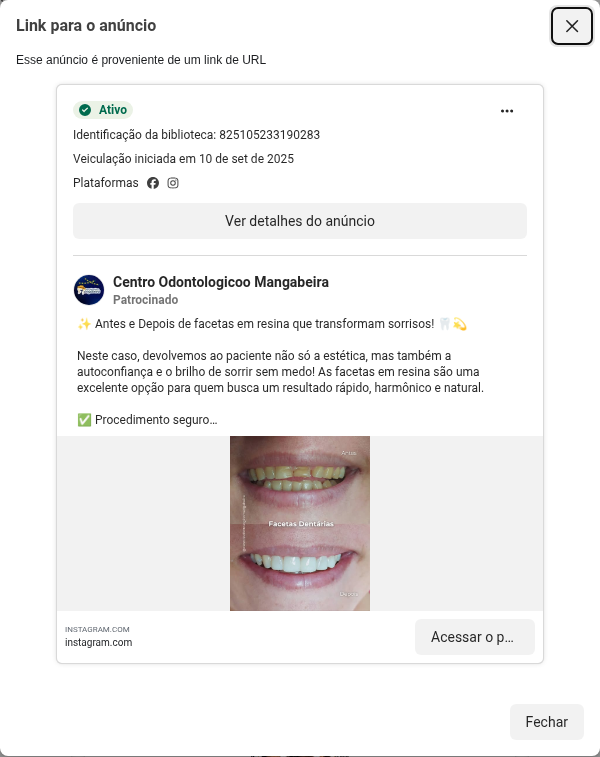{width=75%}

### 13. Dr. Sylvio Simioni

- **Cidade:** SP (CRO-SP) · **No ar:** 1 ano(s) e 1 meses (desde 03/10/2025) · **ID:** 1117822043771797
- **Formato:** imagem única
- **Gancho:** "Retrabalho." (lentes feitas há 3 anos, refeitas mais naturais)
- **Texto principal (trecho):** "⚜️Retrabalho. - Há três anos ela optou por colocar lente de contato dental na arcada superior e inferior, na época até ficou feliz com o resultado, porém, com o passar do tempo, percebeu que poderia ter algo mais natural. . Nosso propósito foi trazer algo…"
- **CTA:** perfil do Instagram
- **Prova:** antes e depois (troca de trabalho antigo)
- **Oferta:** nenhuma
- **O visual mostra:** Dois closes de sorriso com batom vermelho e piercing de nariz, antes e depois; assinatura da clínica.

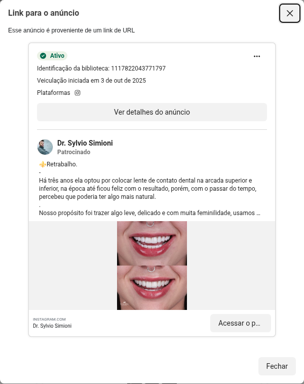{width=75%}

### 14. Dra. Anielle Nami

- **Cidade:** não visível · **No ar:** 10 meses (desde 19/12/2025) · **ID:** 1381494333676476
- **Formato:** imagem única
- **Gancho:** "Ela acreditava que precisaria de lentes em todos os dentes…" (só 4 dentes)
- **Texto principal (trecho):** "Ela acreditava que precisaria colocar lentes em todos os dentes para ter o sorriso que sempre sonhou. Mas a verdade é que nem toda transformação exige tratamentos extensos. Com um planejamento individualizado, acréscimos estratégicos em apenas 4 dentes foram…"
- **CTA:** WhatsApp
- **Prova:** antes e depois (resina composta)
- **Oferta:** nenhuma
- **O visual mostra:** Antes e depois em tela dividida, título "Transformação do sorriso com resina composta" com assinatura da Dra.

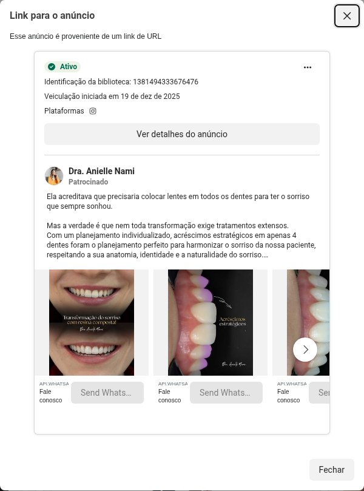{width=75%}

### 15. Odonto San Arapongas

- **Cidade:** Arapongas-PR · **No ar:** 10 meses (desde 06/01/2026) · **ID:** 1388678109304139
- **Formato:** vídeo vertical, mão segurando o trabalho
- **Gancho:** "Chegou a sua chance de conquistar os famosos Dentes de Artistas!"
- **Texto principal (trecho):** "🦷 Chegou a sua chance de conquistar os famosos Dentes de Artistas! As Lentes de Contato Dental são capas ultrafinas que se encaixam perfeitamente nos seus dentes, trazendo naturalidade, harmonia e acabamento impecável. ✔️ Fechamento de espaços ✔️ Correção de…"
- **CTA:** WhatsApp
- **Prova:** bastidor (lentes sobre modelo de gesso)
- **Oferta:** "chance" (sem preço)
- **O visual mostra:** Mãos encaixando as lentes finas no modelo de gesso, fundo de bancada, sem rosto.

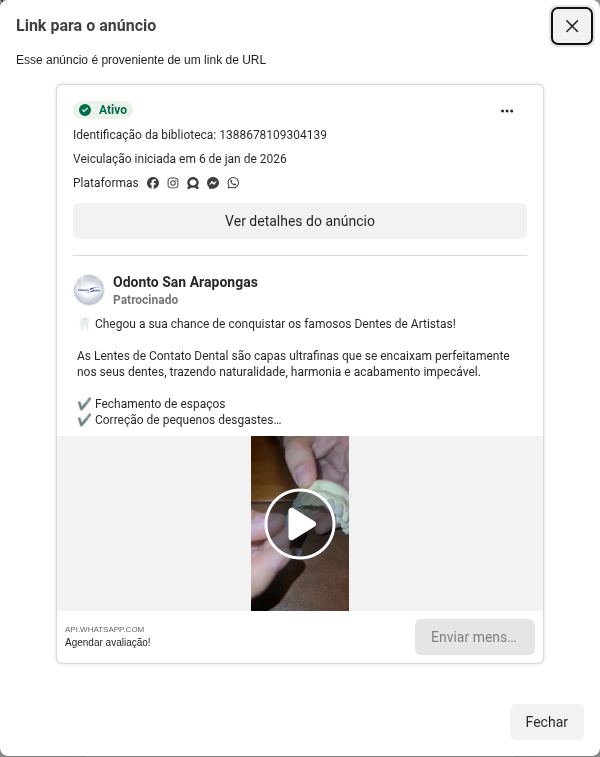{width=75%}

### 16. dr.gêmios

- **Cidade:** São Luís-MA · **No ar:** 10 meses (desde 06/01/2026) · **ID:** 4213866325567348
- **Formato:** vídeo vertical, passo a passo
- **Gancho:** "Ei você de São Luís e região…"
- **Texto principal (trecho):** "Ei você de São Luís e região. Descubra como as facetas em resina podem tornar seu sorriso. uma realidade. 🤩 Agende agora uma avaliação.…"
- **CTA:** "Enviar mensagem" (avaliação)
- **Prova:** bastidor (preparo, polimento, resultado em boca aberta)
- **Oferta:** nenhuma
- **O visual mostra:** Boca aberta com afastador do dente amarelado ao branco, legendas curtas, sem rosto até o fim.

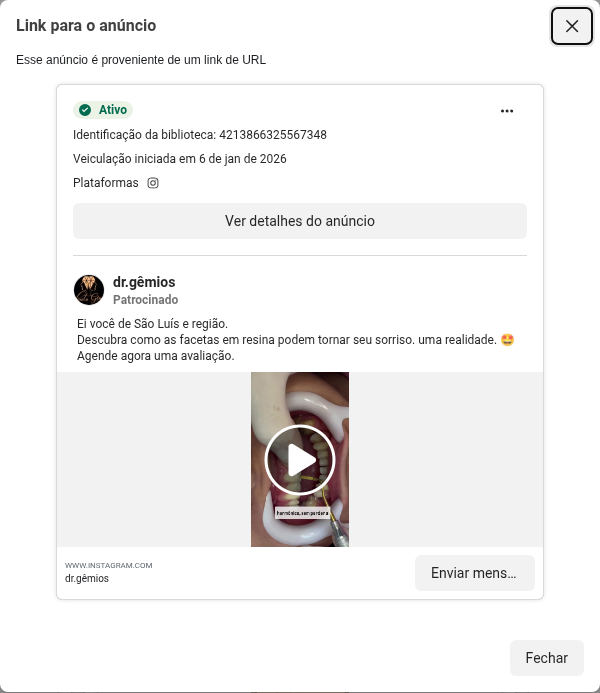{width=75%}

### 17. Ateliê da Faceta

- **Cidade:** não visível · **No ar:** 9 meses (desde 26/01/2026) · **ID:** 1213398586991289
- **Formato:** vídeo vertical, close do sorriso
- **Gancho:** (sem texto) overlay: "Facetas em resina · Sem desgaste · Uma única sessão · Escolha cor e formato"
- **Texto principal (trecho):** "…"
- **CTA:** "Enviar mensagem"
- **Prova:** close do sorriso
- **Oferta:** três promessas fixas na tela
- **O visual mostra:** Sorriso feminino em loop com bloco de benefícios no canto e logo.

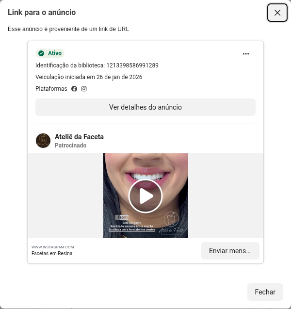{width=75%}

### 18. Instituto Odontológico JP

- **Cidade:** João Pessoa-PB · **No ar:** 9 meses (desde 06/02/2026) · **ID:** 898982719402005
- **Formato:** vídeo vertical, procedimento
- **Gancho:** "Estamos selecionando pacientes para facetas dentárias" + "vagas limitadas"
- **Texto principal (trecho):** "No Instituto Odontológico, estamos selecionando pacientes para facetas dentárias. Uma oportunidade única para transformar seu sorriso com atendimento completo de especialistas! ✅ Corrige manchas, desalinhamentos e desgastes ✅ Resultado rápido e duradouro ✅…"
- **CTA:** WhatsApp
- **Prova:** bastidor (aplicação da resina e fotopolimerização)
- **Oferta:** escassez ("vagas limitadas")
- **O visual mostra:** Boca em close, resina sendo aplicada, faixa azul fixa "Facetas em resina – sorriso transformado sem dor e rápido".

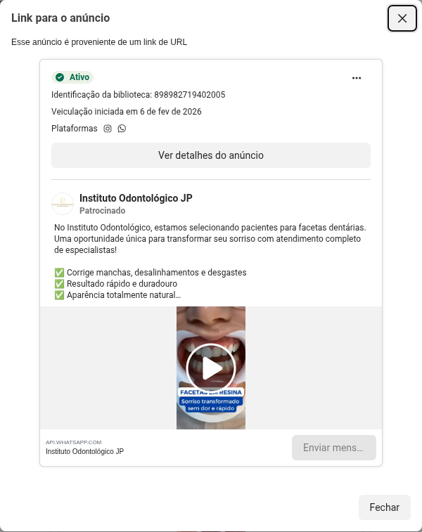{width=75%}

### 19. Oral Prime - Uberlândia

- **Cidade:** Uberlândia-MG · **No ar:** 8 meses (desde 08/03/2026) · **ID:** 1363711608891538
- **Formato:** vídeo vertical, antes/preparo/depois
- **Gancho:** "Luz da madrugada? Só se for o brilho das facetas"
- **Texto principal (trecho):** "Luz da madrugada? Só se for o brilho das facetas 😎✨ Aqui na Oral Prime, a transformação acontece no sorriso e na autoestima. As facetas em resina realçam o que você tem de melhor — trazendo harmonia, confiança e aquele brilho que chama atenção até no escuro.…"
- **CTA:** WhatsApp
- **Prova:** depoimento visual (revelação no espelho) + autorização de imagem no texto
- **Oferta:** nenhuma
- **O visual mostra:** Homem em tratamento, depois rindo no espelho; logo fixa no topo.

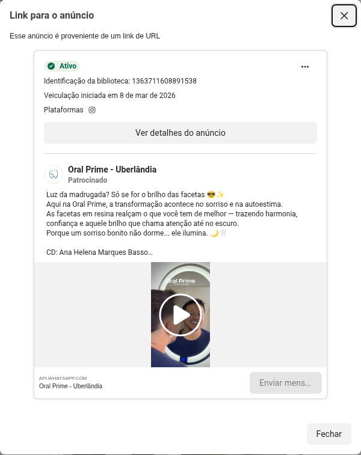{width=75%}

### 20. Oral prime taguatinga

- **Cidade:** Taguatinga-DF · **No ar:** 7 meses (desde 17/03/2026) · **ID:** 26062072076748771
- **Formato:** vídeo vertical
- **Gancho:** "Facetas em Taguatinga e região: ou você tem, ou fica pra trás"
- **Texto principal (trecho):** "🔥 Facetas em Taguatinga e região: ou você tem, ou fica pra trás 🔥 Sorriso apagado não impressiona ninguém. Mancha, dente torto, desgaste, falha? Tudo isso entrega insegurança antes mesmo de você abrir a boca. As facetas dentárias não são luxo — são…"
- **CTA:** "Enviar mensagem"
- **Prova:** bastidor (preparo) + sorriso final
- **Oferta:** "sem dor, sem desgaste, sessão única"
- **O visual mostra:** Paciente em atendimento, faixa azul com "Facetas em resina Premium" e as três promessas.

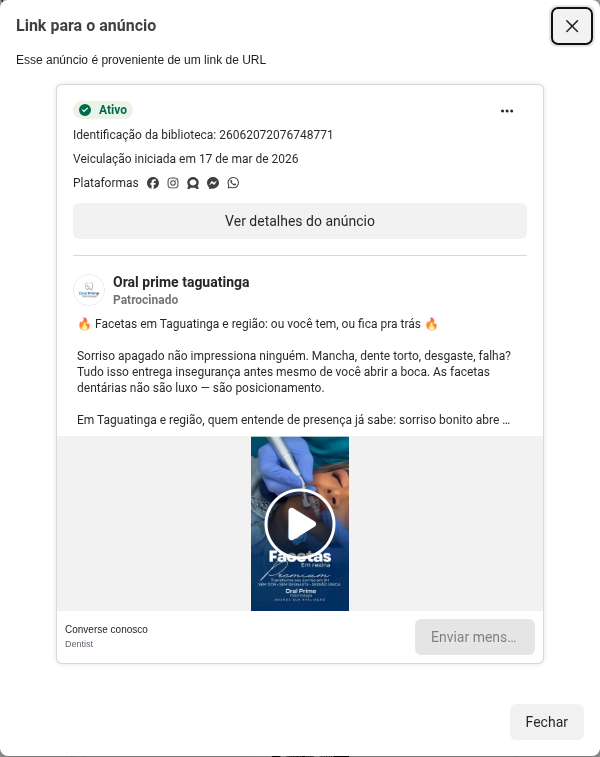{width=75%}

### 21. Dra Bianca Brandão

- **Cidade:** não visível · **No ar:** 7 meses (desde 19/03/2026) · **ID:** 1025287467340200
- **Formato:** vídeo vertical, close
- **Gancho:** "Quer ser paciente modelo de Facetas em Resina?"
- **Texto principal (trecho):** "Se você está procurando uma solução para restaurar seus dentes, as facetas em resina podem ser uma opção a considerar. As facetas de resina dental são uma técnica de restauração não invasiva que usa uma resina especial para cobrir a superfície dos dentes,…"
- **CTA:** "Enviar mensagem"
- **Prova:** close do sorriso
- **Oferta:** vaga de "paciente modelo" (condição implícita)
- **O visual mostra:** Sorriso de lado, câmera rodada, texto-pergunta fixo no topo.

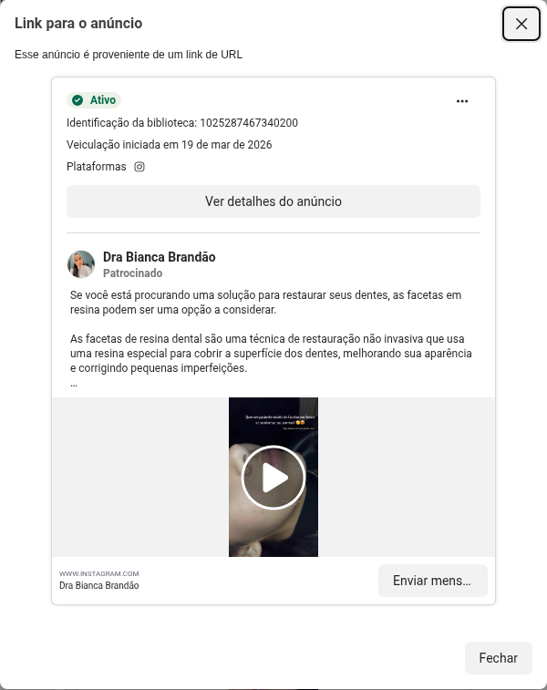{width=75%}

### 22. Dr. Matheus Lima

- **Cidade:** não visível · **No ar:** 7 meses (desde 26/03/2026) · **ID:** 966530659168603
- **Formato:** vídeo vertical, estilo UGC/vlog
- **Gancho:** "O valor das lentes dentais pode variar muito conforme onde são produzidas" + legenda "não coloque lente de contato dental"
- **Texto principal (trecho):** "Você sabia que o valor das lentes dentais pode variar muito dependendo de onde elas são produzidas? No consultório do Dr. Matheus Lima, contamos com laboratório próprio, o que reduz intermediários, diminui custos e permite entregar lentes em resina e…"
- **CTA:** WhatsApp
- **Prova:** depoimento da paciente ("super insegura") + bastidor da clínica
- **Oferta:** condição: laboratório próprio, "preço mais acessível"
- **O visual mostra:** Corte de vlog: paciente falando, estúdio de foto, escaneamento, paciente rindo.

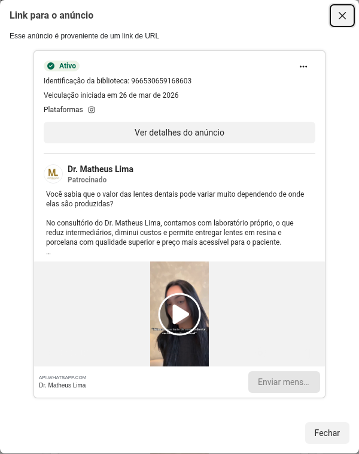{width=75%}

### 23. Diego Aud Gonçalves com La Lumière Clinique

- **Cidade:** Recife-PE · **No ar:** 7 meses (desde 02/04/2026) · **ID:** 2021367325457626
- **Formato:** vídeo vertical, revelação
- **Gancho:** "Naturalidade é o verdadeiro luxo no sorriso"
- **Texto principal (trecho):** "✨ Naturalidade é o verdadeiro luxo no sorriso. Neste caso realizamos facetas em resina estratificadas, reproduzindo detalhes que existem em dentes naturais: translucidez, textura e profundidade de cor. O resultado não é um sorriso “feito”. É um sorriso…"
- **CTA:** perfil do Instagram
- **Prova:** depoimento visual (revelação) + close
- **Oferta:** nenhuma
- **O visual mostra:** Paciente de roupão ri diante do espelho, cortes para o sorriso de baixo para cima, tom premium.

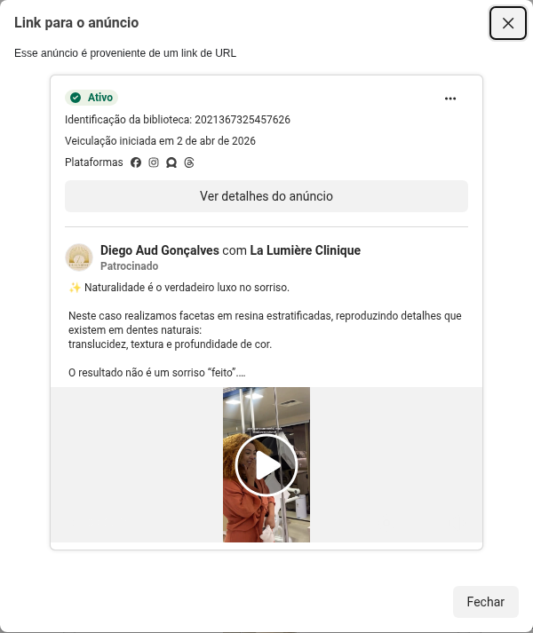{width=75%}

### 24. Ballalai Odontologia

- **Cidade:** Bauru-SP · **No ar:** 7 meses (desde 10/04/2026) · **ID:** 1229186072347698
- **Formato:** vídeo vertical, dentista falando
- **Gancho:** "Você tem medo de fazer facetas dentárias e ficar com um sorriso artificial?"
- **Texto principal (trecho):** "Você tem medo de fazer FACETAS DENTÁRIAS e ficar com um sorriso artificial? 😰 Calma, as facetas respeitam o formato natural dos seus dentes, sua personalidade e o que você deseja transmitir no sorriso. ✨ Nada de ‘dente branco demais’ ou formato padronizado é…"
- **CTA:** WhatsApp: "Clique no botão abaixo e agende uma avaliação"
- **Prova:** dentista falando + closes de sorrisos
- **Oferta:** nenhuma
- **O visual mostra:** Texto-pergunta na capa, dentista de rosa explicando, closes de sorrisos naturais, cartão final com botão.

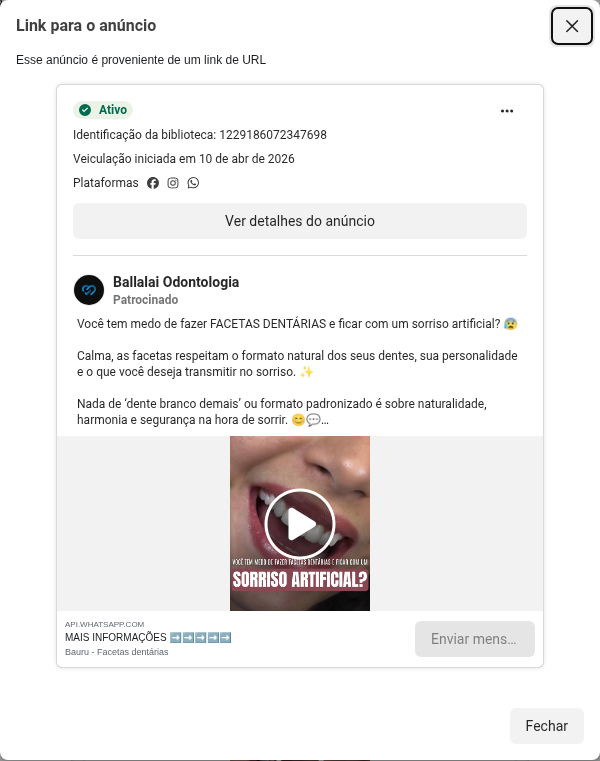{width=75%}

### 25. Ortho Brasil

- **Cidade:** Ceará (CRO-CE) · **No ar:** 6 meses (desde 24/04/2026) · **ID:** 4281118472136859
- **Formato:** imagem única
- **Gancho:** "Promoção imperdível: facetas superiores + inferiores (20 dentes)"
- **Texto principal (trecho):** "Somos referência nos procedimentos com facetas em resina, contamos com a melhor equipe pra te atender. ✅Procedimento rápido e sem desgaste, corrige imperfeições sem alterar a personalidade do sorriso e você escolhe a cor da sua faceta. 📲 Clique em ENVIAR…"
- **CTA:** WhatsApp: avaliação "gratuitamente"
- **Prova:** close do sorriso (arte promocional)
- **Oferta:** promoção e avaliação gratuita
- **O visual mostra:** Arte verde-claro com selo "R$ clique no link" e foto de sorriso num círculo.

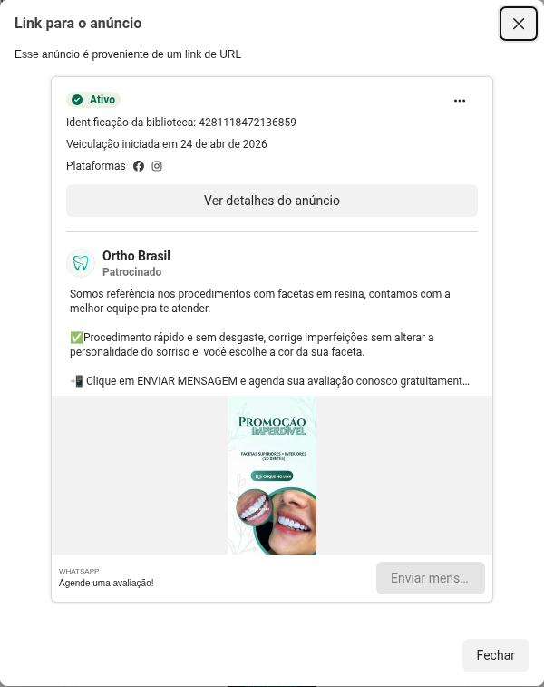{width=75%}

### 26. OdontoCompany Samambaia DF

- **Cidade:** Samambaia-DF · **No ar:** 6 meses (desde 07/05/2026) · **ID:** 1533171034911528
- **Formato:** vídeo vertical, revelação
- **Gancho:** "O sorriso dos sonhos existe… e ela acabou de conquistar o dela!"
- **Texto principal (trecho):** "✨🦷 O sorriso dos sonhos existe… e ela acabou de conquistar o dela! 🦷✨ A transformação com as facetas dentárias mudou não só o sorriso da nossa paciente, mas também a sua autoestima e confiança. 😍💙 Nada é mais gratificante do que ver a felicidade de quem volta…"
- **CTA:** botão com nota 5,0 / agendar avaliação
- **Prova:** depoimento visual (reação da paciente ao espelho)
- **Oferta:** nenhuma
- **O visual mostra:** Paciente de jaqueta jeans na clínica, abraços, ri para o espelho.

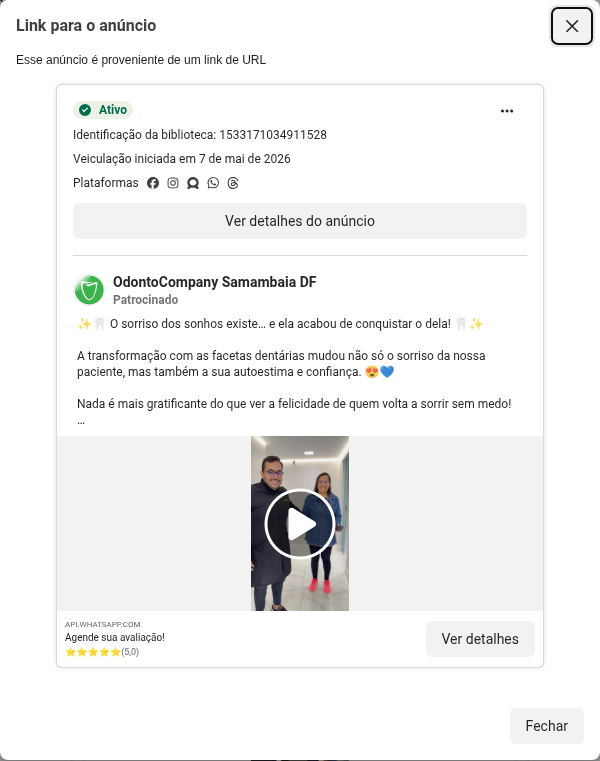{width=75%}

### 27. Dra. Carmelita Brito

- **Cidade:** não visível · **No ar:** 6 meses (desde 13/05/2026) · **ID:** 4399437556993184
- **Formato:** vídeo vertical, revelação
- **Gancho:** "O sorriso vai muito além da estética" + lista "sem desgaste, sem dor, sem anestesia, sessão única, reversível"
- **Texto principal (trecho):** "O sorriso vai muito além da estética: ele reflete autocuidado, saúde e harmonia. ✨🤍 A transformação que valoriza sua essência! ⚜️ SEM DESGASTE ⚜️ SEM DOR ⚜️ SEM ANESTESIA ⚜️ SESSÃO ÚNICA ⚜️ REVERSÍVEL Cada sorriso é único, e os resultados variam de acordo com…"
- **CTA:** WhatsApp
- **Prova:** depoimento visual (cliente emocionado) + closes
- **Oferta:** cinco promessas em lista
- **O visual mostra:** Homem tatuado se vê no espelho ("vou dar risada"), cortes para close das facetas.

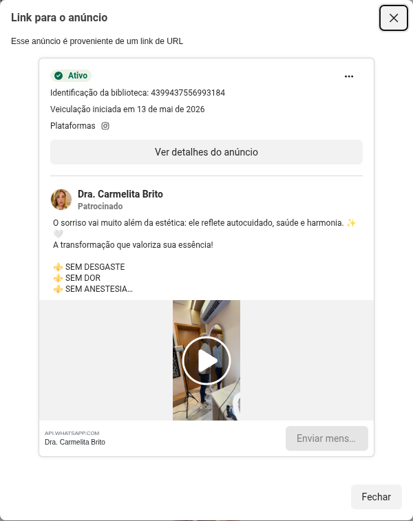{width=75%}

### 28. sorriadenteodontologia

- **Cidade:** Curitiba-PR · **No ar:** 5 meses (desde 29/05/2026) · **ID:** 1006270708531752
- **Formato:** imagem única
- **Gancho:** "Sorriso novo em apenas 1 dia!" + "R$ 1.000 por arcada"
- **Texto principal (trecho):** "✨ SORRISO NOVO EM APENAS 1 DIA! ✨ Chegou a sua oportunidade de transformar o sorriso com Facetas em Resina por apenas R$ 1.000 por arcada! ✅ Procedimento realizado no mesmo dia✅ Resultado imediato✅ Mais harmonia e autoestima✅ Condições especiais por tempo…"
- **CTA:** "Enviar mensagem"
- **Prova:** nenhuma (retrato do dentista sorrindo)
- **Oferta:** preço, "condições especiais por tempo limitado"
- **O visual mostra:** Fundo preto, "FACETAS EM RESINA" em letras grandes, "R$ 1.000" gigante, retrato do dentista.

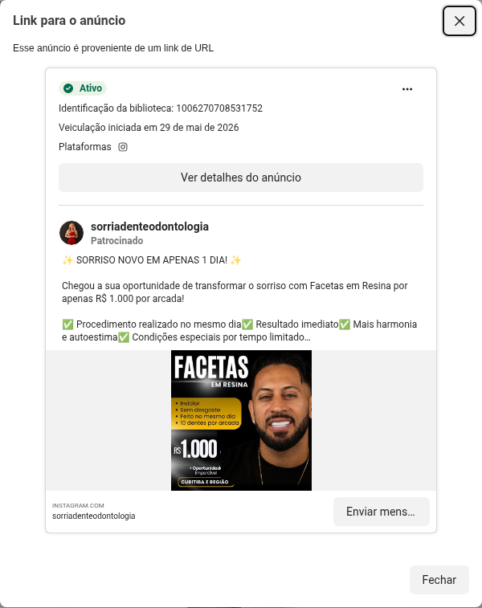{width=75%}

### 29. Lux Estética Odontológica - Sorocaba

- **Cidade:** Sorocaba-SP · **No ar:** 4 meses (desde 29/06/2026) · **ID:** 1506915737063509
- **Formato:** vídeo vertical, close
- **Gancho:** "Saia daqui com um sorriso NOVO no mesmo dia!"
- **Texto principal (trecho):** "Saia daqui com um sorriso NOVO no mesmo dia! 🤩 Você não precisa esperar semanas nem passar por procedimentos invasivos pra ter o sorriso que sempre sonhou. Com as facetas em resina, a transformação acontece em UMA ÚNICA sessão! 🦷 Indolor 🦷 Sem desgastar seus…"
- **CTA:** WhatsApp / comentar "QUERO"
- **Prova:** close do sorriso
- **Oferta:** "R$ 1.999 à vista", "tempo limitado"
- **O visual mostra:** Close lateral de sorriso com cartão de preço fixo no topo.

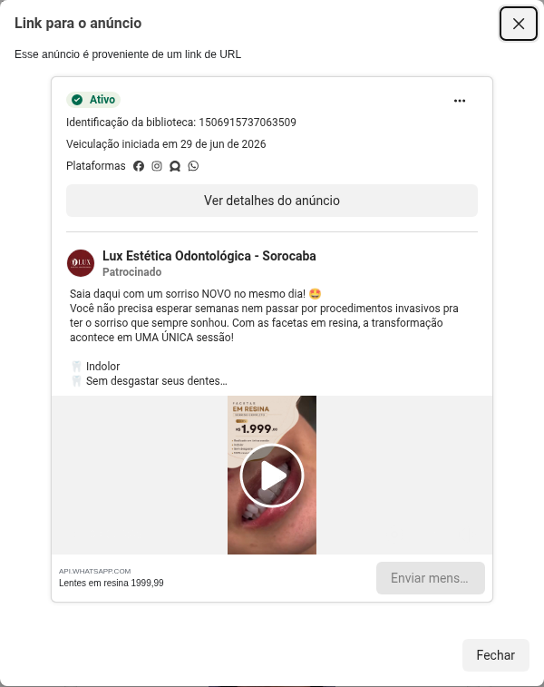{width=75%}

### 30. Camargo Odontologia

- **Cidade:** Goiânia-GO · **No ar:** 2 dias (desde 07/11/2026) · **ID:** 1459159342850604
- **Formato:** vídeo vertical (motion de retratos)
- **Gancho:** "Cada rosto tem a sua própria identidade… design de sorriso exclusivo"
- **Texto principal (trecho):** "Cada rosto tem a sua própria identidade, e o seu sorriso merece refletir o que você tem de melhor. Na Camargo Odontologia, unimos tecnologia de ponta e precisão para criar um design de sorriso exclusivo para você. Nossas Facetas e Lentes de Contato Dental são…"
- **CTA:** WhatsApp: "Agende uma avaliação"
- **Prova:** close do sorriso / retratos de mulheres (sem antes e depois)
- **Oferta:** nenhuma
- **O visual mostra:** Retratos sorrindo, escala de cor de dente na mão com luva, texto "tecnologia para planejar, precisão para transformar".

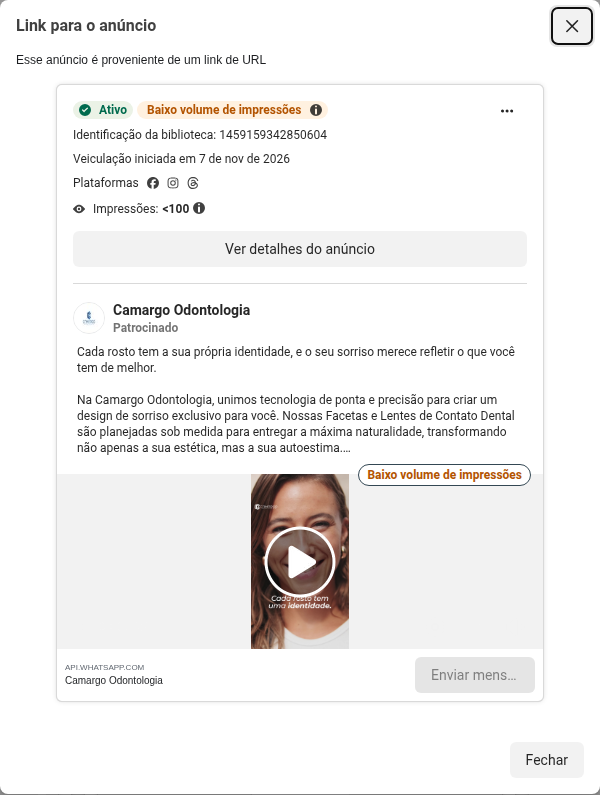{width=75%}

# 5. Os 14 criativos da Dra. contra o que funciona

Os 14 são 5 anúncios: 1, 2 e 3 (story 1080x1920, capa + 3 cartões cada = 12 peças) e 4 e 5 (feed 1080x1350). Lidos em `criativos-v2/anuncios`. **Nada foi alterado: só recomendação.**

**Leitura geral:** gancho e tom estão certos; o botão (Enviar mensagem, WhatsApp) é o do mercado; a prova (close de sorriso) existe nas capas. Falta **vídeo, a Dra. em cena, convite explícito e um anúncio 5 com imagem**.

| Anúncio | Veredito | Mudança principal |
|---|---|---|
| 1 Naturalidade (4 peças) | Alinhado no tema, fraco no gancho | Virar vídeo e abrir com a dúvida, não com a tese |
| 2 Preservação (4 peças) | **Mais alinhado de todos** | Responder falando (vídeo) e firmar a resposta |
| 3 Escultura (4 peças) | Diferencial real, pede vídeo | Usar reels-mao como principal |
| 4 Feed com close | Alinhado, estático de baixa duração esperada | Adicionar contexto e convite; testar contra vídeo |
| 5 "Dente de chiclete" | Melhor gancho, pior formato | Dar imagem ou vídeo com a Dra. falando |

## Anúncio 1: "Dente natural não é uma cor só" (capa, q2, q3, q4)

- **Capa:** close do sorriso com título central. **Alinhado:** naturalidade aparece em 55% dos anúncios e a imagem é um close forte. **Gancho** é uma afirmação, não dúvida ou desejo; pelos padrões, abre melhor com pergunta (exemplo a validar com a Dra.: "Por que alguns dentes de resina parecem todos iguais?").
- **Cartões q2 e q3:** texto explicativo (translucidez, camadas). Bons para quem já parou, **longos para o primeiro segundo**. O estilo "explica o processo" aparece em anúncios longevos (Clínica Gomes, 817 dias), mas **em vídeo falado**.
- **q4:** fecha com "Facetas em resina esculpidas à mão" e a assinatura. **Falta CTA de ação.**
- **Mudar:** (1) vídeo: corte-2 ("Dente natural não é de uma cor só") como versão principal; (2) texto principal começa com a dúvida e deixa a tese para o segundo parágrafo; (3) último cartão com "Toque em Enviar mensagem".

## Anúncio 2: "Faceta estraga o dente?" (capa, q2, q3, q4)

- **Gancho: forte e comprovado.** Objeção de desgaste é a pergunta que mais dura (COP Berimbau 511 dias; Carmelita 180; "sem desgaste" em 12% dos textos). A capa (close de faceta de perto) combina.
- **Resposta:** "o mais conservadora possível, com mínimo ou nenhum desgaste, conforme o caso" é **honesta e CFO-segura, mas hesitante**; os concorrentes dizem "sem desgaste" em lista. Não prometer isso, mas **dizer falando**, em primeira pessoa, o que a Dra. faz de diferente na prática (exemplo de direção, o texto é da Dra. e precisa da aprovação dela: o que ela faz na prática para preservar o dente).
- **q3:** "só na avaliação a Dra. confirma" é o convite à avaliação, **sem ação de contato**.
- **Mudar:** vídeo curto da Dra. respondendo (formato COP Berimbau); cartão final com convite para chamar. Manter o gancho.

## Anúncio 3: "Cada faceta, esculpida à mão" (capa, q2, q3, q4)

- **Capa** com resina em camadas é **diferencial real**: só 1 dos 30 (La Lumière, "estratificada") fala de técnica de escultura. Não é concorrido.
- **Gancho** é de ofício, não de dor. Funciona para quem já conhece facetas, não para quem quer sorrir mais sem medo. **q2 repete a capa**, quase sem informação nova.
- **"5 anos dedicados a facetas em resina"** é credencial boa (equivalente ao "referência", "CRO", "mestre" dos concorrentes) e já confirmada por ela.
- **Mudar:** é o anúncio que mais pede vídeo (reels-mao, 18 s, "tudo feito à mão"): o que o concorrente mostra em bastidor (6 dos 30) a Dra. tem de melhor. Trocar a repetição do q2 por um convite explícito.

## Anúncio 4: feed com close "Dente natural não é de uma cor só"

- **Alinhado:** close nítido de sorriso (como 5 dos 30), tom sóbrio (polo premium, como Simioni e Camargo). Estático de feed tende a durar menos que vídeo se não mostrar transformação.
- **Falta:** contexto (de quem é, que é caso real), e o **convite**: o texto principal já diz "toque em Enviar mensagem", mas a arte só traz a tese.
- **Mudar:** testar **par A/B com o vídeo corte-2** (mesmo gancho): é o teste mais limpo de vídeo contra estático. Manter este como controle.

## Anúncio 5: "Medo de ficar com cara de dente de chiclete?"

- **Melhor gancho do pacote** pelo benchmark: medo de sorriso artificial aparece em anúncios de 213 e 228 dias (Ballalai, Matheus Lima) e 20% das peças.
- **Pior formato:** texto sobre fundo sálvia, sem foto, sem rosto. Nenhum dos 30 usa arte só de texto com sobriedade; o único (Ouse Sorrir, "procuram-se") compensa com cor forte e selo. É a peça com menos chance de parar a rolagem.
- **Mudar:** (1) vídeo da Dra. falando 15 a 20 s ("direção do roteiro, texto da Dra.: reconhecer o medo e mostrar como ela evita o resultado artificial") no formato Ballalai (213 dias); (2) se ficar estático, colocar foto de sorriso natural no lugar do fundo liso; (3) convite para conversar.

## Vídeos já gerados (não estão entre os 14)

`criativos-v2/videos` tem corte-1 (10 s), corte-2 (10 s), corte-3 (9 s) e reels-mao (18 s), com os mesmos textos dos anúncios 1 a 3 e cartão final. Não os conferi quadro a quadro neste estudo. Recomendo usá-los como **versão principal** de 1, 2 e 3, e gravar a Dra. falando para 2 e 5.

# 6. Como testar (sugestão, sem verba definida)

Mesma campanha e público, só o formato muda:

1. **Teste 1 (formato):** anúncio 4 estático contra corte-2 em vídeo. Decisão por **conversas iniciadas no WhatsApp e conversas qualificadas**, nunca por curtida ou visualização, que foi o erro de 2025.
2. **Teste 2 (gancho):** anúncio 5 com foto contra a Dra. falando o mesmo gancho.
3. **Teste 3 (CTA):** mesmo vídeo, com e sem a frase de convite no texto.

Um teste por vez, janela de 7 dias, e só trocar o que o teste muda.

# 7. Regras: o que fica de fora de propósito

- Nenhum criativo de terceiros foi copiado. Reaproveitar **estrutura** (vídeo curto, pergunta de abertura, convite) é livre; reaproveitar imagem, vídeo, texto ou marca de outro anunciante não é.
- **Preço, promoção, urgência, "avaliação gratuita", "vagas limitadas"**: aparecem no benchmark (R$ 1.000 por arcada, R$ 1.999, "promoção imperdível") e ficam fora, por regra do CFO/CRO-GO (conferir o texto vigente) e por decisão da Dra.
- **Antes e depois, depoimento de paciente e reação filmada:** a Dra. não quer reação emocionada filmada, e antes e depois está vedado pela regra interna do projeto. Se algum voltar, só com termo de imagem e conferência com o CRO-GO.
- Sem "especialista" enquanto o título não estiver registrado no CRO.

# Anexo: onde estão os prints

Pasta `benchmark/` do repositório: 30 prints (um por exemplo, numerados como na seção 4) da página de cada anúncio na Biblioteca de Anúncios, com ID e data de início visíveis. Dados brutos completos da coleta (126 anúncios) ficaram fora do repositório.
