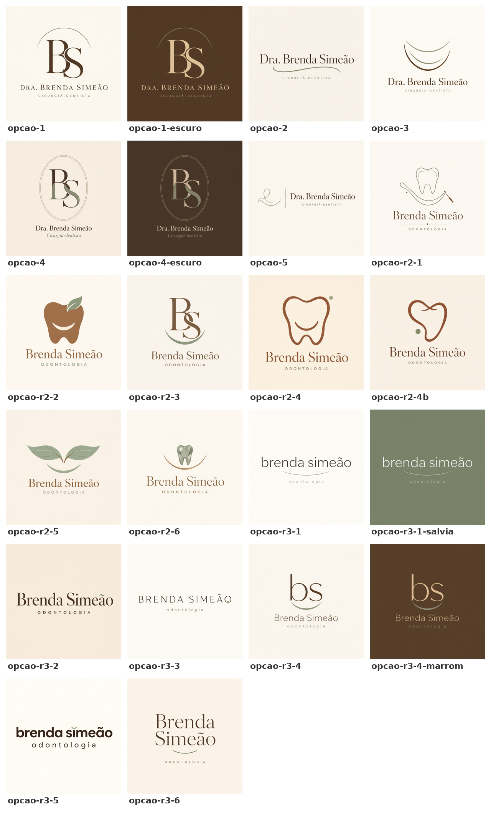

# Opções de logo — qual é qual

Dra. Brenda Simeão · Expoente · Outubro de 2026

São 22 imagens em PNG, em três rodadas. Na pasta de logos, cada imagem tem o nome da tabela abaixo. Para escolher, basta dizer o nome (por exemplo: "opcao-r3-4").

## Rodada 1 — monogramas e assinaturas

| Nome | O que é |
|---|---|
| opcao-1 | Monograma BS com arco fino, fundo claro |
| opcao-1-escuro | Mesmo monograma BS com arco, fundo marrom |
| opcao-2 | "Dra. Brenda Simeão" com traço curvo de assinatura |
| opcao-3 | "Dra. Brenda Simeão" com curvas de sorriso acima do nome |
| opcao-4 | Monograma BS dentro de um oval fino, detalhe em sálvia, fundo claro |
| opcao-4-escuro | Mesmo monograma em oval, fundo marrom |
| opcao-5 | Assinatura manuscrita ao lado do nome, em linha horizontal |

## Rodada 2 — símbolos ilustrados

| Nome | O que é |
|---|---|
| opcao-r2-1 | Dente em traço fino com curva de sorriso e instrumento |
| opcao-r2-2 | Dente em forma de maçã, marrom, com folha sálvia |
| opcao-r2-3 | Monograma BS com sorriso em sálvia |
| opcao-r2-4 | Dente em contorno marrom com um sorriso dentro |
| opcao-r2-4b | Dente em traço único, com laço e um ponto |
| opcao-r2-5 | Duas folhas em sálvia sobre um sorriso |
| opcao-r2-6 | Dente em cristal sobre um arco |

## Rodada 3 — só tipografia

| Nome | O que é |
|---|---|
| opcao-r3-1 | "brenda simeão" em minúsculas, fundo claro |
| opcao-r3-1-salvia | Mesmo desenho, fundo verde sálvia |
| opcao-r3-2 | "Brenda Simeão — odontologia", serifada, fundo bege |
| opcao-r3-3 | Letras maiúsculas espaçadas, traço fino |
| opcao-r3-4 | Monograma "bs" em minúsculas com sorriso, fundo claro |
| opcao-r3-4-marrom | Mesmo monograma "bs", fundo marrom |
| opcao-r3-5 | "brenda simeão — odontologia" em letra sem serifa, mais forte |
| opcao-r3-6 | "Brenda Simeão" em duas linhas, serifada |
